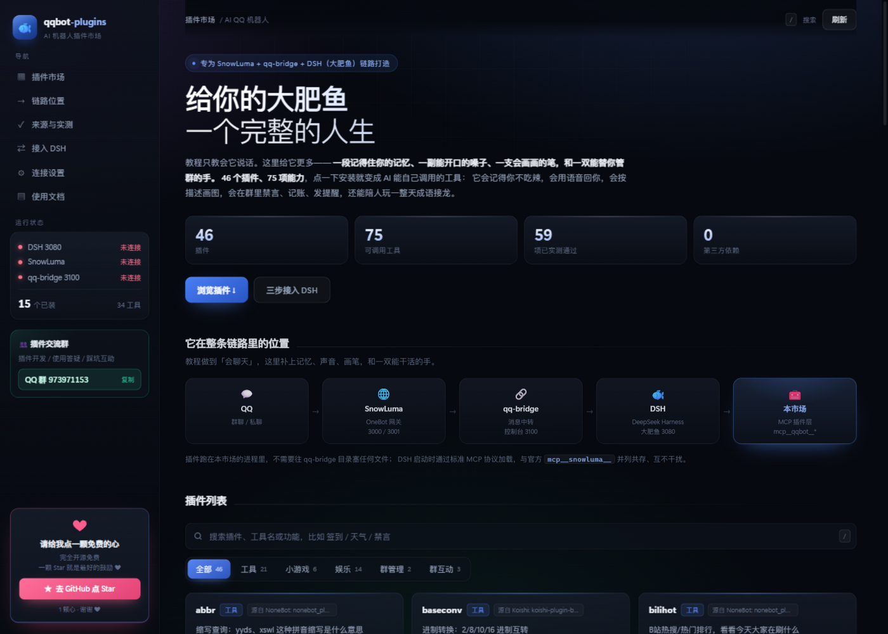
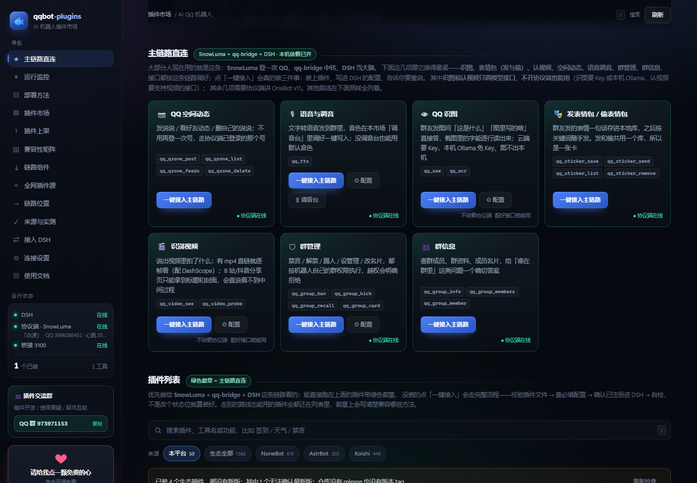

# 🐟 qqbot-plugins — AI QQ 机器人插件市场

> **给你的大肥鱼一个完整的人生。**
> 给「SnowLuma + qq-bridge + DSH（大肥鱼）」这条链路补上记忆、声音、画笔，和一双能干活的手。

按抖音上很火的那套教程把 DeepSeek 接进 QQ 之后，你会发现一个问题——
**它会说话，但没有生活。** 你让它"禁言这个人十分钟"，它只能回你一句解释；
你跟它聊三天，它转头就忘了你是谁。

这个市场就是它的人生补丁：**50 个插件 / 84 项能力**，网页上点一下安装，
就变成 AI 能自己调用的工具（`mcp__qqbot__*`）。从此它**记得住你**（长期记忆）、
**开得了口**（语音合成）、**画得了画**（文生图）、**看得懂图**（识图/OCR）、
**存得下表情包**（偷图/发表情）、**认得视频**（多模态视频理解）、**管得了群**（禁言/踢人/公告），
还会查天气、记账、发提醒、陪人玩成语接龙。

```
QQ  ⇄  SnowLuma  ⇄  qq-bridge  ⇄  DSH（大肥鱼）  ⇄  DeepSeek
                                        │
                                        └── ⇄  qqbot-plugins（MCP 插件层）
                                                50 个插件 / 84 个工具
```

零第三方依赖 · 一个命令启动 · 网页里配置 · MIT 开源



[](https://nodejs.org)
[](./LICENSE)
[](#插件一览)
[](#插件来源与实测)

---

## 这是什么

一句话：**它是那条抖音教程链路的官方「插件补充包」，现在也是一个「部署方法 × 插件」的聚合平台。**

教程做到的是「QQ 消息 ⇄ DeepSeek 对话」。但它没解决「AI 怎么操作 QQ」——
不能发消息、不能禁言、不能查群成员、不能记账。而这些恰恰是群友最想要的功能。

| | 只有教程 | 加上本市场 |
| --- | --- | --- |
| 能聊天 | ✅ | ✅ |
| 会查天气、翻译、汇率 | ❌ 只会凭记忆瞎编 | ✅ 真调接口拿真实数据 |
| 能禁言 / 踢人 / 撤回 / 发公告 | ❌ | ✅ 带白名单和二次确认 |
| 能签到、记账、备忘、定时提醒 | ❌ | ✅ 数据落地保存 |
| 能玩成语接龙、21 点、猜数字 | ❌ | ✅ 会记住上一句 |

**它不改你的教程环境。** 不 fork qq-bridge、不往它的目录塞文件、不动 SnowLuma 配置，
只是在 DSH 的 `cordis.patch.yml` 里并列追加一个 MCP 服务器——和官方
`mcp__snowluma__` 用的是同一份文件、同一种格式，互不冲突。

- **市场侧**：登录 → 浏览/搜索 50 个插件 → 一键安装/卸载/启停/配置，实时探测链路状态
- **主链路直连**：把 SnowLuma + qq-bridge + DSH 这条（大部分人用的那条）单独提到首页第一屏，
  七张卡（QQ 识图 / 发表情包·偷表情包 / 识别视频 / 空间动态 / 语音调音 / 群管理 / 群信息）
  点「一键接入」就走完整流水线
  （校验插件 → 查必填配置 → 写状态 → 确认已注册进 DSH → 自检）。其他路线照常保留，只排序靠后。
  识图和认视频只调模型接口，不开协议端也能用；其余五项要协议端在线。
- **部署方法**：10 条路线（SnowLuma+DSH 排第一并标「站内主推」，另有 NapCat+AstrBot / NapCat+Koishi /
  NapCat+NoneBot2 / 官方通道等），
  每条都标清：个人号还是官方号、要不要桌面 QQ、Node/Python/Docker 依赖、端口、关键配置；
  本机能自动的才给「部署」按钮，只给步骤的绝不放假按钮（详见 [docs/METHODS.md](docs/METHODS.md)）
- **兼容性矩阵**：10 种方法 × 8 类插件生态，按真实能力标注，不写「全兼容」；
  插件安装前展示静态扫描出的权限清单，能写文件/发消息的必须勾选确认
- **AI 侧**：`node scripts/register-dsh.mjs desktop` 把市场注册进 DSH → 重启 DSH → AI 工具列表里出现全部已装插件
- **配置侧**：连接渠道（OneBot 地址/Token）、群管理白名单、默认城市等，全部在网页里填，改完立即生效
- **安全侧**：踢人/全体禁言等危险操作必须 `confirm=true`；群管理还支持管理员 QQ 白名单与「只允许操作的群」双重护栏；
  API Key / AppSecret 用 AES-256-GCM 加密存储，日志自动打码，不收集 QQ 密码（一律扫码）



### 「装到 QQ 上」到底是什么意思

不需要把插件文件复制进 qq-bridge 目录。插件由**市场自己的进程**（`mcp-server.mjs`）提供，DSH 通过 MCP 标准协议调用它，插件再通过 SnowLuma 的 OneBot API 操作 QQ。所以：

- 装插件 = 在市场点「安装」（只改一个状态文件，不往别人的仓库里塞东西）
- 生效 = 重启 DSH（AI 的工具列表在启动时加载）
- 卸载 = 点「卸载」再重启，工具就从 AI 手里消失了

## 快速开始

**环境要求**：Node.js **≥ 20**（插件沙箱用的是 Node 权限模型 `--permission`，20 以下没有这个开关，
市场能起但插件全部无法执行——所以别用 18）。Windows / macOS / Linux 都能跑，`start.bat` 只是
Windows 的快捷方式，其他平台直接 `node server.js`。**零第三方依赖**，不用 `npm install`。

**推荐方式（一键部署）**：启动本站后，打开侧栏「部署链路」——协议端、桥接、DSH 注册、插件，
每一环都能在那里点「部署」，真的检查、下载、启动、自检；能自动的全自动，只有「登录 QQ」
这种必须你动手的会停下来告诉你做什么。详见 [docs/INSTALL.md](docs/INSTALL.md)。

```bash
# 0. 前置：已按教程跑通 SnowLuma + qq-bridge + DSH（DSH 里发一句话有回复）

# 1. 拉取并启动市场
git clone https://github.com/qqbot-hub/qqbot-plugins.git
cd qqbot-plugins
node server.js
# 浏览器打开 http://127.0.0.1:3210 → 侧栏「部署链路」点一键部署

# 2. 填连接渠道（推荐在网页里点「连接设置」；也可以复制配置文件手改）
copy config.example.json config.json

# 3. 搭桥：把市场注册进 DSH（profile 名看 ~/.dsh/profiles/ 下的子目录名）
node scripts/register-dsh.mjs desktop

# 4. 【关键】完整退出并重启 DSH（MCP 只在启动时加载）
#    然后在 DSH 里搜 mcp__qqbot__ —— 能搜到即搭桥成功 ✅

# 5. 链路体检（随时可跑）
node scripts/doctor.mjs
```

之后在 QQ 里对机器人说"帮我禁言他十分钟""查下北京天气""开一局成语接龙"，AI 就会自己调用对应插件。

## 配置（都在网页里填）

### 1）连接设置 —— 插件和 QQ 通信的渠道

左侧导航点「连接设置」，或搭桥区点「连接设置」：

| 字段 | 说明 |
| --- | --- |
| OneBot HTTP 地址 | SnowLuma 的 HTTP API，默认 `http://127.0.0.1:3000`。发消息、禁言、查群都走这里 |
| AccessToken | SnowLuma 配了 token 才需要填；留空表示不修改已保存的值 |
| WebSocket 端口 | 默认 3001，仅用于体检探测 |
| DSH 地址 / profile 名 | 默认 `http://127.0.0.1:3080` 和 `desktop`，用于体检与一键搭桥 |

改完**立即生效**——`mcp-server.mjs` 每次被 AI 调用时都会重新读这份配置，不用重启 DSH（只有增删插件才需要重启）。

### 2）插件配置 —— 群管理等需要权限的插件

有配置项的插件，卡片上会多一个「⚙ 配置」按钮。目前：

**group_admin（群管理）**

| 字段 | 作用 |
| --- | --- |
| 管理员 QQ 白名单 | 非空时，只有名单里的人发起，禁言/踢人/公告等才会执行；AI 必须如实传 `operator_id` |
| 允许操作的群号 | 非空时，只对这些群生效，防止 AI 在别的群误操作 |
| 默认禁言时长 | 群友没说"禁多久"时用这个分钟数 |
| 危险操作需二次确认 | 保持开启时，踢人/全体禁言/设管理员必须带 `confirm=true` |

**weather（天气）**：默认城市，群友只说"今天天气怎么样"也能直接查。

> 白名单是"防误操作"的护栏，不是绝对安全边界——`operator_id` 由 AI 传入。真正兜底的是机器人自己的群权限（SnowLuma 侧）和只在可信群里使用。要加新的可配置插件，看 [docs/PLUGIN_SPEC.md](docs/PLUGIN_SPEC.md) 里的 `settings` 声明方式。


## 安全：这个面板谁能打开

默认**只监听 `127.0.0.1`**，局域网里别人扫不到；也**不设口令**，本机上谁打开浏览器都能进。
这两条是配套的——只在本机用就没有问题，但如果你做了端口转发、或者把它放到有别人的机器上，
先设口令：

```json
// config.json
{ "password": "换成你自己的口令" }
```

设了之后打开页面会跳登录页，登录后种一个 HttpOnly Cookie（30 天）。口令不对不给进，
API 也一样（`/api/onebot/event` 例外，那是协议端上报入口，只收本机来源 + 可选的 AccessToken）。

密钥怎么存：

- 方法级令牌（OneBot AccessToken / Satori token）和插件级 API Key（voice / imagine）
  都是 **AES-256-GCM 加密后写进 `config.json`**，形如 `enc:v1:...`；接口只回"配过没有"，不回值。
- 加密用的 key 在 `data/state/.secrets.key`，**这个文件丢了就解不回来**，要备份就跟 `config.json` 一起备份。
- `config.json`、`data/state/`、`runtimes/` 都在 `.gitignore` 里，别手滑提交上去。

插件本身跑在独立子进程里，写文件 / 起子进程由 Node 权限模型直接拒绝，边界写在
[docs/SANDBOX.md](docs/SANDBOX.md)（包括它**拦不住**什么：网络出站、CPU 配额、代码签名）。


## 插件一览（50 个）

| 分类 | 数量 | 插件 |
| --- | --- | --- |
| 工具 | 24 | calc 计算 · weather 天气 · translate 翻译 · exchange 汇率 · unit 单位换算 · baseconv 进制 · morse 摩斯电码 · passgen 密码 · abbr 缩写解释 · remind 定时提醒(主动消息) · memo 群备忘 · ledger 群记账 · birthday 生日倒计时 · clock 报时 · jukebox 点歌链接 · pomodoro 番茄钟(主动消息) · coin 抛硬币 · color 颜色卡 · bilihot B站热门 · bingimg 必应每日图 · **voice 语音合成(TTS)** · **vision 识图/OCR(多模态)** · **video 认视频(多模态)** · ping 测活(收消息示例) |
| 娱乐 | 14 | fortune 今日运势 · dice 骰子/多选一 · draw 抽签 · sensoji 赛博浅草寺 · tarot 塔罗 · zodiac 星座 · meihua 梅花易数 · hitokoto 一言 · joke 冷笑话 · quote 毒鸡汤 · riddle 脑筋急转弯 · poem 古诗 · gacha 抽群友卡 · **imagine AI 画画** |
| 小游戏 | 6 | blackjack 21点 · guess 猜数字 · bombgame 数字炸弹 · idiom 成语接龙 · wordle 猜单词 · roulette 轮盘点名 |
| 群管理 | 2 | group_admin 禁言/踢人/撤回/名片/头衔/公告 · group_info 群资料/成员列表 |
| 群互动 | 4 | signin 群签到积分榜 · qzone QQ空间说说 · **sticker 表情包(偷图/发表情)** · **memory 长期记忆/好感度** |

合计 **50 个插件 / 84 个工具**。分类与数量由 `data/catalog/plugins.json` 统一驱动，市场页面按此分组筛选。

另有 1 个**配套桌面程序**（dsh-pet 桌面宠物），单独成区、不占 MCP 工具位，详见下文。

## 插件来源与实测

这一节把话说清楚，避免误会。

### 来源：目录是收集的，代码是本项目重写的

| 内容 | 真实来源 |
| --- | --- |
| 50 个插件的**名称、功能描述、工具名、参数说明** | 抓取自公开的 QQ 插件市场站点的插件目录数据 |
| 每张卡片上的「源自 xxx」 | 该插件的上游出处（AstrBot / NoneBot / Koishi / Yunzai 社区的同名插件），附仓库链接 |
| **每个插件的可执行代码** | 本项目重新实现。原站的插件依赖它自己的加载器，公开数据里不含实现代码；这里全部改写为**零依赖的 MCP 工具**，跑在 Node 上 |

所以准确的说法是：**目录来自网络社区，实现由本项目重写**——不是"把网上的插件原样搬过来"。
好处是全部零依赖、直接能跑、不受上游框架版本影响；代价是行为细节以本项目实现为准。

### 实测：84 个工具全部跑过一遍

```bash
node scripts/verify-plugins.mjs          # 跑全部插件
node scripts/verify-plugins.mjs --json   # 输出机器可读结果
```

最近一次结果（本机、未开 QQ）：

| 结果 | 数量 | 含义 |
| --- | --- | --- |
| ✅ 实测通过 | **64** | 真实调用并正常返回（含天气、汇率、B站、翻译等联网插件，拿的是真实数据） |
| 🔌 需 QQ 在线 | 16 | group_admin(8) + group_info(3) + qzone(4) + sticker 发表情(1)，本机没开 SnowLuma 所以发不出去，属于环境问题 |
| 🔑 需配置 | 4 | voice 语音合成 1 项、vision 识图 2 项、video 认视频 1 项：没填对应接口的 Key，填上即可用 |
| ❌ 失败 | **0** | — |

脚本会自动把存储重定向到临时目录，不会污染你的真实数据；你可以随时自己跑一遍复核。

### 边界：哪些事它做不了

- **不抓版权内容**：点歌插件只返回网易云/QQ音乐/酷狗的搜索链接，不下载音频
- **群管理受权限限制**：机器人本身得是群管理员，SnowLuma 的 HTTP API(3000) 必须开着
- **联网插件依赖公开接口**：断网或接口挂了会明确告诉你失败，不会假装成功
- **管理员白名单是护栏不是铁门**：`operator_id` 由 AI 传入，真正兜底的还是机器人自身群权限 + 只在可信群使用

## 与「大肥鱼」的关系

抖音上那套「大肥鱼」机器人（[Gitee: luo_sang/qqbot](https://gitee.com/luo_sang/qqbot)）是一个**单体的 Python 程序**
（`bot.py` + `persons.py`），能力包括对话、语音、表情包、心情状态机、人物记忆、主动发消息、视频生成等。

需要说明的是：**它没有插件系统**，没有 `plugin/` 目录，也没有插件 API 或钩子，
功能扩展只能改配置或用它内置的模块。所以「把它的插件导入这里」这件事做不到——
它根本没有插件形态，而且 Python 单体程序和这里的 Node MCP 工具不是一回事。

两者的关系是**互补**：

- 大肥鱼负责「像人一样聊天」：人格、语气、记忆、心情、语音、表情包
- 本市场负责「替人办事」：查数据、管群、记账、玩游戏、定时提醒

本项目与该开源项目**没有隶属关系**，未使用其代码、素材或预设，只作为它生态里的第三方插件补充；
「大肥鱼」在这里是对该机器人项目的指称。

如果你的 DSH 用的就是大肥鱼那套人格预设，本市场挂在同一台机器上即可，
DSH 会同时加载人格和这些工具——它既能用大肥鱼的口吻说话，又能真的动手做事。


> 插件灵感与能力对标 AstrBot / NoneBot / Koishi / Yunzai 生态的同类插件（目录数据中保留了对应上游出处），但实现全部为本仓库原创、零依赖、面向 MCP 工具调用设计。部分联网插件使用免费公开接口（Open-Meteo / er-api / nbnhhsh / B站 / 必应），无需任何 API Key。

## 搭桥原理（为什么能和教程里的方法连起来）

详见 [docs/BRIDGE.md](docs/BRIDGE.md)。一句话版本：

1. qq-bridge 官方通过 `~/.dsh/profiles/<profile>/cordis.patch.yml` 给 DSH 挂 MCP 服务器（`snowluma`、`web-search-safe` 等）；
2. 本项目用**同一配置文件、同一格式**追加一个自己的条目 `mcp-qqbot`（serverName `qqbot`），指向本仓库的 `mcp-server.mjs`（stdio JSON-RPC）；
3. DSH 启动时加载它，全部已安装插件的工具以 `mcp__qqbot__<tool>` 出现；
4. 插件内部需要操作 QQ 时，走 SnowLuma 的 OneBot HTTP API（端口 3000）——和 qq-bridge 用的是同一条通道。

所以：**不 fork qq-bridge、不改它任何文件、不和它的 MCP 冲突**，教程链路原样保留，只做加法。

## 开发自己的插件

两套出口，可只写一套，也可都写：

| 出口 | 什么时候用 | 谁触发 |
|---|---|---|
| `tools` | 给 AI 调用的能力（查天气、算个卦） | DSH 里的 AI |
| `handlers` | 群里有人发消息就要响应（命令、关键词） | 真实 QQ 消息 |

**直接复制模板**：`plugins/_template/`（`index.mjs` 骨架 + `test.mjs` 自检）。
自检不用连 QQ：`node plugins/_template/test.mjs` → 21 项断言，覆盖匹配、权限、限流、回复。

最小例子（工具型）：

```js
export default {
  meta: { id: 'hello', name: 'hello', description: '打招呼', category: '娱乐' },
  tools: [{
    name: 'qq_hello',
    description: '跟某人说你好',
    inputSchema: { type: 'object', properties: { who: { type: 'string' } }, required: ['who'] },
    run: async ({ who }) => `你好，${who}！`,
  }],
};
```

消息驱动型（真收群消息）：

```js
export default {
  meta: { id: 'mycmd', name: 'mycmd', description: '响应 /hi', category: '工具' },
  handlers: [{
    id: 'hi',
    match: { prefix: '/hi' },        // 也支持正则 / 字符串 / {contains} / 函数
    scope: ['group', 'private'],
    permission: 'everyone',           // everyone | admin | owner
    cooldownMs: 3000,
    async run(msg, api) {
      await api.reply(`你好，${msg.nickname}`);
    },
  }],
};
```

放到 `plugins/<id>.mjs`、在 `data/catalog/plugins.json` 加一条，市场里就能看到。
细节见 [docs/PLUGIN_SPEC.md](docs/PLUGIN_SPEC.md)、[docs/MESSAGE.md](docs/MESSAGE.md)。

## 跨部署方法装插件

如果你部署的是 AstrBot / NoneBot / Koishi，市场里点「安装」装的是**那些生态的插件**，
不是上面这些 JS 插件 —— 它们装进各自框架、写各自的配置，然后验证「真的被加载」：

```bash
node scripts/installer.mjs run nonebot-plugin --package=nonebot-plugin-apscheduler
node scripts/installer.mjs run astrbot-plugin --repo=https://github.com/作者/插件仓库
node scripts/installer.mjs run koishi-plugin  --package=koishi-plugin-dataview
```

三条路线的原理、踩过的坑、怎么验证见 [docs/ECOSYSTEM.md](docs/ECOSYSTEM.md)。

## 市场里的生态插件（1368 个真实条目）

市场顶部有一条「来源」，可以在**本平台 50 个**和**三种生态的真实商店**之间切换：

| 来源 | 数量 | 数据来自 | 安装方式 |
|---|---|---|---|
| NoneBot | 619 | `registry.nonebot.dev/plugins.json` | `pip install` 进 venv + 写 `pyproject.toml` |
| AstrBot | 300 | GitHub `topic:astrbot-plugin`（按 star 排序） | `git clone` 进 `data/plugins/` |
| Koishi | 455 | npm 搜索（npmmirror 镜像） | `npm install` 进 Koishi 的 `node_modules` |

这些不是我们编的条目，是**真去三个商店抓回来的目录**（`data/sources/ecosystem.json`），
每条都带可用的安装参数。卡片上会明确写「装进 NapCatQQ + NoneBot2」——因为它们是**原生插件**，
必须先有那个框架的运行时，装不到别的地方去。

目录会过期，点页面上的「同步」重新抓；也可以在命令行：

```bash
node scripts/sync-ecosystem.mjs            # 重新抓三个源（约 10 秒）
node scripts/sync-ecosystem.mjs --status   # 只看缓存状态，不联网
```

## 已装插件的新版本检查

生态插件不像本平台插件（代码就在本地），它们来自外部包管理器，所以会过期：

- `GET /api/plugin/updates` 对比**已装版本**与**商店最新版**：NoneBot 查 PyPI、Koishi 查 npm、AstrBot 查 GitHub release/tag
- 状态严格分三种：**有新版 / 已是最新 / 查不到**（附原因，比如「仓库没打 tag」）。查不到绝不写成"已是最新"
- 点「更新」走的是**真的重装**（pip/npm/git），不是改个标记
- 版本没变时**不重启框架** —— 重启一次机器人意味着群里对话全断一次，不该为一个空操作付这个代价

## 插件上架（提交 / 审核 / 版本）

想把自己的插件放进市场，走「插件上架」板块：

1. **提交** —— 填清单 + 贴 `.mjs` 代码。提交时立刻跑 `node --check` 验语法，字段问题一次全列出来
2. **审核** —— 通过 / 拒绝（拒绝必须写原因，会存给作者看）
3. **通过 = 真落地** —— 代码写进 `plugins/<id>.mjs` → 登记进市场目录 → **重建权限表**
   （不重建的话新插件没有权限标注，用户安装时看不到二次确认）
4. **版本** —— 同一 id 换版本号再提交，形成版本历史；`live` 是最后一个通过审核的版本

边界要说清楚：这是**单机登记流程**，没有多用户身份认证，审核拦的是明显不合格的提交，
**不是防恶意投毒**。没有代码签名、没有多租户，别当成公共市场的基础设施。
运行时沙箱是有的：插件跑在独立子进程里，写文件/起进程由 Node 权限模型直接拒绝，
见 [docs/SANDBOX.md](docs/SANDBOX.md)。

完整流程与已知不足见 [docs/REGISTRY.md](docs/REGISTRY.md)。自测：`node scripts/test-registry.mjs`（46 项）。

## 目录结构

```
qqbot-plugins/
├─ server.js            市场服务端（登录/API/体检/搭桥/安装任务，零依赖）
├─ mcp-server.mjs       MCP stdio 服务器（暴露插件工具给 DSH）
├─ plugins/             50 个插件（每个 .mjs 自包含）+ _template/ 开发模板 + _router.mjs 消息路由
├─ recipes/             每个可安装对象一份安装脚本（协议端/桥/DSH/插件/三生态插件…）
├─ data/
│  ├─ catalog/          清单：plugins（插件）/ companions（配套）/ components（链路组件）/ methods（部署方法）/ permissions（权限）
│  ├─ sources/          外部插件源定义 + ecosystem.json（三生态真实目录，1368 条）
│  ├─ snapshots/        外部源抓取快照
│  └─ state/            安装状态 + 安装任务记录 + 三生态已装登记 + 上架审核记录（不入库）
├─ scripts/
│  ├─ installer.mjs     一键安装引擎（分步执行 + SSE 实时日志）
│  ├─ lib/paths.mjs     所有数据文件的唯一路径出口
│  ├─ lib/ecosystem.mjs 三生态索引抓取与归一化
│  ├─ lib/updates.mjs   已装插件的新版本检查（PyPI / npm / GitHub）
│  ├─ lib/version.mjs   宽松版本解析与比较（pre-release、v 前缀、caret）
│  ├─ lib/registry.mjs  上架提交 / 审核 / 落地 / 版本历史
│  ├─ sync-ecosystem.mjs 抓生态目录（可 --status 只看缓存）
│  ├─ register-dsh.mjs  写 cordis.patch.yml 搭桥（自动备份/幂等/--remove）
│  └─ doctor.mjs        链路体检（DSH/SnowLuma/bridge/工具数）
├─ public/              市场前端（原生 HTML/JS，暗色主题）
└─ docs/                部署/搭桥/插件规范/消息接入/生态/上架 文档
```

## 测试

```bash
for t in scripts/test-*.mjs; do node "$t"; done
node plugins/_template/test.mjs      # 插件开发模板自检
node scripts/build-permissions.mjs --check   # 权限表是否与源码一致
```

当前：**283 项，0 失败**（bridge 19 / hub 11 / installer 15 / methods 28 / registry 46 / router 62 / satori 36 / version 45 / 模板 21）。

## 常见问题

| 现象 | 处理 |
| --- | --- |
| DSH 里搜不到 `mcp__qqbot__` | 没重启 DSH。完整退出桌面程序再打开（关浏览器标签不算） |
| 装了插件但 AI 说没有这个工具 | 装/卸/启停后都要重启 DSH 才刷新工具列表 |
| `register-dsh` 报 profile 目录不存在 | 打开 `~\.dsh\profiles\` 看子目录名，用真实名字 |
| 禁言/踢人失败 | 机器人需要群管理员权限；SnowLuma 的 HTTP API(3000) 必须开启 |
| 定时提醒没发出来 | 提醒由 Hub 的 MCP 进程触发，保持 DSH 开着；并确认 OneBot HTTP 可用 |
| 天气/汇率等联网插件失败 | 依赖免费公开接口，检查网络；全部接口无需 Key |

## 安全提醒（和教程一致的三条）

1. **白名单填具体**：机器人能操作群管理，务必只在可信群里使用；
2. **用小号**：机器人自动行为容易触发风控；
3. **危险操作有确认**：踢人/全体禁言/设管理员要求 `confirm=true`，出现意外行为可在市场里一键停用插件。

## 交流群

插件开发、使用答疑、踩坑互助，都在这儿：

> **QQ 群：973971153**（点群号复制，QQ 里搜索加入）

群里会同步插件更新、收集新插件需求。想加插件但不会写的话，把"想要什么功能"发群里就行；
自己写好了想合并进主仓库，也欢迎直接提 PR。

贡献者名单见 [CONTRIBUTORS.md](CONTRIBUTORS.md)。

## 记忆 / 语音 / 画画（三个进阶能力）

这三个是后来加的，正好补上「机器人像个活人」的部分。

### memory —— 长期记忆

机器人能记住关于每个人的事，并在被问到时想起来。

| 工具 | 作用 |
| --- | --- |
| `qq_memory_save` | 记一条长期事实（喜好、生日、约定、群规） |
| `qq_memory_recall` | 按关键词回忆，比如"你还记得我不吃辣吗" |
| `qq_memory_card` | 看某人的印象卡：熟悉度、好感度、记了几条 |
| `qq_memory_forget` | 忘掉某条，或清空某个人的档案 |

不依赖向量库和 Embedding 模型——用「中文二字切片 + 时间半衰期衰减」做检索，纯 JSON 存在本机
`data/store/memory/`，装好就能用。数据不上传任何地方，可随时清空。

> 对标 AstrBot 社区的记忆插件（[memory_beyond](https://github.com/AlanBacker/astrbot_plugin_memory_beyond)、
> [iris_memory](https://github.com/leafliber/astrbot_plugin_iris_memory)、
> [mnemosyne](https://github.com/lxfight/astrbot_plugin_mnemosyne)），实现是本项目重写的零依赖版。

### voice —— 语音合成（TTS）

`qq_tts` 把文字合成语音，直接作为语音消息发到群里。走 OpenAI 兼容的 `/audio/speech`，所以这些都能接：

| 服务 | baseUrl | model | 说明 |
| --- | --- | --- | --- |
| 硅基流动 | `https://api.siliconflow.cn/v1` | `FunAudioLLM/CosyVoice2-0.5B` | 有免费额度，中文效果好 |
| OpenAI | `https://api.openai.com/v1` | `tts-1` | 音色用 alloy / nova / shimmer |
| 自建 GPT-SoVITS / CosyVoice | 你的地址 | 你的模型 | 只要暴露兼容接口即可 |

装好后在卡片点「⚙ 配置」填接口地址、Key、模型、音色。没填 Key 时工具会明确提示，不会静默失败。

> QQ 语音对编码有要求（silk/amr）。多数 OneBot 实现会自动把 mp3 转码；若协议端报错，去协议端开启语音转码。
> 参考 qq-bridge 的 [Edge TTS 语音回复 PR #74](https://github.com/Derpyu520/qq-bridge/pull/74) 与 [edge-tts](https://github.com/rany2/edge-tts)。

### imagine —— AI 画画

`qq_imagine` 说一句描述就出图并直接发到群里。两种后端，配置里切换：

| 后端 | 是否需要 Key | 说明 |
| --- | --- | --- |
| `pollinations`（默认） | 不需要 | 免费，约 1 秒出图，官方按 IP 限流（插件已做缓存 + 三次退避重试） |
| `openai` | 需要 | OpenAI 兼容的 `/images/generations`，可接硅基流动 Kolors、DALL·E、自建 SD 兼容层 |

> 免费后端限流比较严格，连续狂发会被 402。插件对同一句描述做了 10 分钟缓存，
> 真被限流时会告诉群友"稍等十几秒再要"，而不是报错刷屏。
> 参考 [Pollinations](https://github.com/pollinations/pollinations) 与 Yunzai 的 [ap-plugin](https://github.com/yhArcadia/ap-plugin)。

## 支持的协议端

插件**不绑定桥接**，只依赖 **OneBot v11**。所以：

- 桥接是 qq-bridge 还是 SurfCore —— 不影响
- 协议端是 SnowLuma / NapCat / LLOneBot / Lagrange / go-cqhttp —— 都支持

适配层（`plugins/_bridge.mjs`）已经吃掉四种差异：响应格式（`status` / `retcode` / 裸数据）、
鉴权方式（Header / query token / 不鉴权）、个别动作名不同（如群公告，且**学会就记住**），
以及心跳探测（自动认出是哪个实现、哪个 QQ、延迟多少）。

装好后网页侧栏会显示「协议端 · SnowLuma」，下面一行是「昵称 · QQ 号 · 心跳 24ms」，每 20 秒刷一次。

在网页「连接设置 → 协议端」里选一下就行，**改完不用重启 DSH**。

详见 [docs/PROTOCOLS.md](docs/PROTOCOLS.md)。自测：`node scripts/test-bridge.mjs`（19 项）。

## 全网插件源（平台模式）

市场不只陈列自己写的 50 个插件，还像外卖平台一样把**各家店摆上同一张桌**：
`data/sources/external.json` 定义了 Yunzai / NoneBot / Koishi / AstrBot / OneBot 生态的真实查询源，
`node scripts/hub-sync.mjs` 一键抓成统一目录（截至 2026-10-28：6 个源、204 个仓库），
网页「全网插件源」板块可以直接搜索、按平台筛选、按星数排序。

- **目录接入 ≠ 能直接装**：外部插件依赖各自框架的加载器；每张卡片提供「看源码」和
  「复制适配提示词」，让 AI 按本市场规范把它重写成零依赖的 `.mjs` 插件
- 首次同步的快照随仓库提交，离线也能看；页面可随时重新抓取（60 秒冷却防限流）
- 配套的调音台（Voice Lab，本机 3120）也通过 `/lab/` 反向代理接进了市场

详见 [docs/HUB.md](docs/HUB.md)。自测：`node scripts/test-hub.mjs`（11 项）。

## 与 SurfCore 共存

[SurfCore](https://github.com/Mieksido/surfcore) 是另一套「QQ × B站 × 桌宠」的完整栈，它**接替 qq-bridge 的位置**。
两者可以并存在同一个 DSH 上：SurfCore 负责"她是谁"（身份、记忆、作息、语音、B站、桌宠），本市场负责"她能做什么"（群管、记账、游戏、画画）。

三个要点：

- **端口 3100 二选一** —— 装了 SurfCore 就不要再启动 qq-bridge
- **两个脚本各写各的块** —— 装完 SurfCore 再跑本市场的 `register-dsh.mjs`，互不覆盖
- **记忆/语音会重复** —— 建议只留一套；语音可以用本市场的 `voice` 插件直连 SurfCore 的 voxd 引擎（免 Key，共用音色）

完整说明（含冲突清单和操作顺序）见 [docs/INTEGRATION-SURFCORE.md](docs/INTEGRATION-SURFCORE.md)。

## 配套桌面程序：dsh-pet 桌面宠物

网页里「配套桌面程序」一栏放着 [MerZlin/dsh-pet-indesktop](https://github.com/MerZlin/dsh-pet-indesktop) 的下载入口——
就是那只蓝色大肥鱼的桌面版。

| | 说明 |
| --- | --- |
| 形态 | **独立桌面程序**（Python + PySide6），装在自己电脑上，不是 QQ 插件、也不进 DSH |
| 功能 | 透明置顶、可拖拽、106 段动画、自说自话、待办提醒、全局快捷键；Chat 版还能直接和 DeepSeek 对话 |
| 平台 | Windows（安装版 / 便携版）、macOS（Apple 芯片）、Linux x86_64 |
| 协议 | MIT |

它和本站的关系是**同一个角色形象的两种形态**：QQ 里那只是"在群里干活的大肥鱼"，
桌面这只坐在你屏幕上陪你。两者互不依赖，装不装都不影响。

> 本站只提供跳转到该项目 GitHub Releases 的下载按钮，不代下、不重新打包、不修改其二进制。
> 下载后请以该项目的说明为准；Windows 可能提示"未知发布者"，这是未签名的正常现象。

## 本地语音引擎：Breeze-TTS-2.cpp

除了云端 TTS，`voice` 插件也能直接接本地引擎 [HoppouAI/Breeze-TTS-2.cpp](https://github.com/HoppouAI/Breeze-TTS-2.cpp)
（C++ + GGUF，英中双语，支持音色设计/克隆/语气指令，Vulkan 加速，自带 HTTP 服务）。

它天生就适配——因为它提供的 `/v1/audio/speech` 就是 OpenAI 兼容接口：

```bash
# 1. 下载并解压（Windows / Linux 预编译在 Releases，模型权重在 HuggingFace）
# 2. 启动服务（默认 8080，权重 Q8_0 约 3.3GB）
breeze-server breeze-tts-2-q8_0.gguf --host 127.0.0.1 --port 8080

# 3. 在市场里点 voice 的「⚙ 配置」
#    后端 = 本地 Breeze-TTS-2.cpp
#    接口地址 = http://127.0.0.1:8080/v1
#    API Key = 留空（本地不需要鉴权）
#    语气指令 = 可选，如「轻声、慢一点」
```

配好后 `qq_tts` 就会走本机合成：**不需要 Key、不联网、数据不出门**，还多出两个云端给不了的能力——
`instruction`（用一句话描述语气）和 `voice_id`（保存/克隆的音色）。

> **许可提醒**：源码 Apache-2.0，但**模型权重是非商用许可（BreezeBlue）**，商用需要另行授权。
> 另外它的服务没有鉴权，务必只绑定 `127.0.0.1`，不要暴露到公网。

## 版权与第三方说明（不侵权）

本项目从零实现，可以放心使用和二次分发：

| 内容 | 来源 |
| --- | --- |
| 界面（HTML/CSS）、图标、Logo | 本仓库原创手写，仅使用纯 CSS 与手绘 SVG，**未使用任何第三方 UI 框架、图标库、字体或图片素材** |
| 50 个插件的代码 | 本仓库原创实现，零第三方依赖 |
| 插件目录里的「源自 xxx」标签 | 仅是对同类功能上游项目的**文字致谢**（AstrBot / NoneBot / Koishi / Yunzai 社区），不包含、不复制其任何代码；这些项目各自遵循其自身许可 |
| 联网插件调用的接口 | Open-Meteo、er-api、nbnhhsh、一言、B 站公开接口、必应每日图等公开接口，按其公开使用条款调用，无需 Key |

字体走系统字体栈，不发网络请求；不抓取任何版权音视频内容（点歌插件只返回平台搜索链接）。仓库整体采用 MIT 协议。

## License

MIT © 2026 [xiazhuo123456789](https://github.com/xiazhuo123456789)
